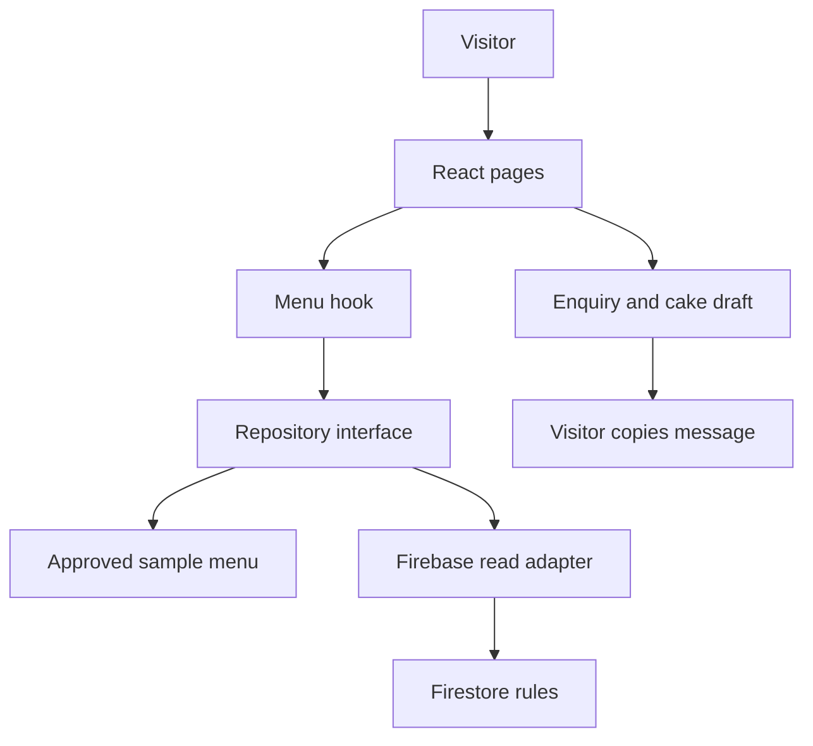

# See how the pieces connect

Think of the website as a shop: **components are the counter, the repository fetches the menu ledger, Firebase will be the storeroom**.

Only one data source is active. The default `demo` source uses `menu.seed.ts`; `firebase` must be deliberately configured. A failed cloud read shows an error and retry button.

## Folder map

| Folder | Responsibility | Analogy |
|---|---|---|
| `src/app` | Compose routes, shared visitor state and page sections | Shop floor |
| `src/components` | Menu card and accessible dialog | Counter fittings |
| `src/features/menu` | Types, query logic, price/special rules, loading hook | Menu rules |
| `src/data` | Explicit sample menu | Practice menu ledger |
| `src/repositories` | Select data source and read records | Staff fetching the ledger |
| `src/lib/firebase` | Validate settings and initialise SDK | Storeroom connection |
| `src/styles` | Brand tokens and mobile layouts | Shop appearance |
| `public/images` | Approved, cropped food images | Photo cupboard |
| `docs` | Decisions and cross-device handoff | Project memory |

## State ownership

- URL query: category, search, sort, saved-only, available-only. Reload/share the URL to reproduce a filtered view.
- App context: menu records, request state, enquiry lines and active modal.
- localStorage: **only saved dish IDs**. Saved favourites are device/browser specific, not synced accounts.
- Cake form: local component memory; no network write or storage.

## Data contract

`MenuItem` is in `src/features/menu/types.ts`. Prices use integer ZAR cents. `fixed` and `from` need a positive safe integer; `quote` requires null. Unknown prices never become zero. Dates are ISO strings in the UI, converted from Firestore timestamps by the adapter. Special start is inclusive; end is exclusive. Public queries require `published == true`. No per-card listeners.

The current adapter is intentionally read-only. No admin screen pretends to authenticate, save or upload. Add Auth, trusted admin provisioning, form/runtime validation and tested rules together in the owner-tools milestone.

## Design and portability choices

Standard CSS replaces the originally suggested Tailwind utility layer for this first preview, keeping the colour tokens and responsive rules visible in one file. React Router, TypeScript, Vite, npm and Firebase modular SDK remain standard packages. No Sites runtime is required to run the downloaded source; `.openai/hosting.json` only configures its current private deployment.
