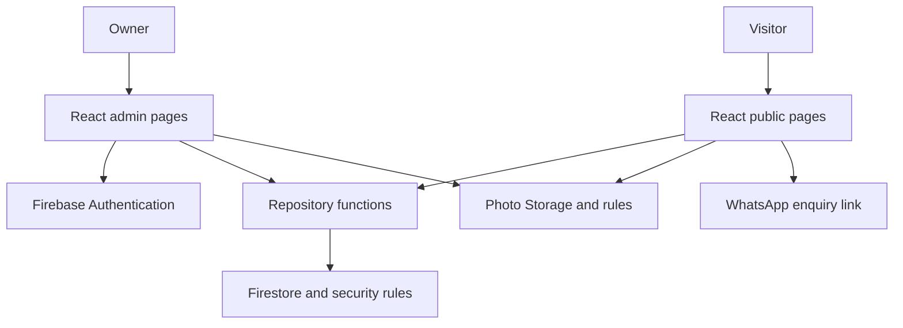

# Dooks Meatlovers — implementation and portability blueprint

Version: 1.0 | Prepared 2 November 2026

## 1. Purpose and working agreement

Build a mobile-first website for a family-run South African bakery and BBQ deli. Sibonelo is the developer and learner. Start implementation in Google Antigravity; continue the same repository later in VS Code with Codex. All source must remain readable, editable and portable. No proprietary runtime dependency is acceptable merely because an AI tool generated the project.

Use this document as the initial build brief. Save it as `docs/blueprint.md` in the repository. Requirements, architecture and decisions subsequently recorded in the repository are authoritative. Work one milestone at a time; demonstrate it and wait for Sibonelo to indicate satisfaction before moving to the next milestone. Do not generate the entire application in one pass.

Current evidence: Node, npm, Git and Git identity were checked on the personal computer. A folder outside OneDrive was created. React scaffolding was instructed but completion was not confirmed. Antigravity must inspect its actual workspace first: reuse existing appropriate code; never overwrite or recreate a project blindly.

## 2. Business context and content authority

User-provided design direction: rustic South African BBQ, smokehouse, street food, local and approachable. Offerings provided: smoked brisket specials, loaded kotas, sharing platters, bakery and custom cakes. Custom cakes do not have fixed prices. The family has no dedicated marketing team; routine updates must not require coding.

Brand direction: charcoal/dark timber backgrounds; parchment cream text; burnt orange accents; Oswald Bold headings; Inter body text; large food photographs. Suggested Tailwind tokens: stone-950, orange-100 and orange-700. These are design choices from the handoff, not sampled official brand specifications. Check contrast for every text/button combination; orange accent colours are not automatically accessible.

Instagram reference: @dooks_meatlover. Screenshots were shared in another project chat and the user states permission to use them. Those image bytes and their detailed contents are not present in this build brief. Do not claim to have inspected them. Obtain the approved assets in the active build workspace; keep approved web-sized photographs and logo files in the repository. Never hotlink Instagram images. If assets are unavailable, use visibly labelled placeholders during development.

Unconfirmed: exact trading name spelling, address, coordinates/map link, WhatsApp number, phone, hours, complete menu/prices, dietary/allergen statements, logo files and domain. Record these in `docs/content-checklist.md`; do not invent them. Disable incomplete contact actions rather than linking to a made-up destination. Obtain owner confirmation before release. No fake reviews or claims such as halal certification.

## 3. First release and exclusions

Public: homepage, featured specials, filterable menu, cake quote section, visit/contact details and WhatsApp enquiries. Menu states: loading, empty, error and sold out. Specials may have expiry times; expired offers must stop appearing as active specials without someone manually editing a poster.

Owner: email/password sign-in, sign-out and password reset; create/edit menu items; set prices; upload/replace photos when storage is enabled; publish/unpublish; mark sold out; feature/unfeature; set special dates; reorder items; edit business details. Use archive/unpublish as the default removal action.

Exclude checkout, payments, delivery management, customer accounts, loyalty schemes, custom backend server and WhatsApp Business API integration. WhatsApp opens a prefilled message that the visitor chooses to send. It does not automatically place or confirm an order. Do not store enquiries or personal cake details in Firestore in v1.

## 4. Tooling decisions

| Concern | Choice | Reason |
|---|---|---|
| Initial AI workspace | Google Antigravity | User's chosen starting environment |
| Later AI workspace | VS Code with Codex | Continue editing the same source |
| Source and handoff | Git + private GitHub repository | History and cross-device access |
| UI | React + TypeScript | Reusable components and explicit data types |
| Development/build | Vite | Standard local tooling and static build |
| Styling | Tailwind CSS with documented tokens | Consistent brand styling; use installation instructions for the chosen release |
| Navigation | React Router | Public routes and protected admin routes |
| Firebase | Modular Web SDK | Firestore, Auth, Storage integration |
| Forms | React Hook Form + Zod | Reusable form handling and validation; rules must also validate writes |
| Local state | React state/context | No Redux requirement for this scope |
| Checks | TypeScript, ESLint, Prettier | Consistency and static checks |
| Tests | Vitest, React Testing Library; Firebase rules tests; Playwright | Test pricing, security and important journeys |
| CI | GitHub Actions | Validate pull requests independently of the editor |
| Hosting | Firebase Hosting | Host the Vite static build with SPA rewrites |

Choose a supported Node LTS release compatible with selected dependencies, record its exact version in `.nvmrc` and the README, and declare a matching supported range in package.json. Do not assume a version string from a previous machine is the desired standard. Use npm throughout and commit package-lock.json. Do not mix lockfiles or install every suggested library before its milestone needs it. Pin the Firebase CLI as a project development dependency when introduced, then use `npx firebase`.

## 5. Architecture and routes



The UI is the shop counter. Repository functions are the staff retrieving menu information. Firestore is the menu ledger; Storage is the photo cupboard. Authentication checks identity; security rules decide what that identity may access.

Routes: `/` homepage including specials and cake/contact sections; `/menu` complete menu; `/admin/login`; `/admin`; `/admin/menu/new`; `/admin/menu/:id/edit`; `/admin/settings`; catch-all not-found page. Public navigation links should work on direct reload. Admin routes are lazy-loaded where practical.

Component map:

```text
App
  AppProviders / Router
  PublicLayout
    Header / MobileNavigation
    HomePage
      HeroSection
      FeaturedSpecials / MenuCard
      MenuPreview / MenuCard
      CustomCakeSection / WhatsAppLink
      VisitSection
    MenuPage
      CategoryFilter / MenuGrid / MenuCard / PriceDisplay
    Footer / FloatingWhatsAppLink
  AdminGuard
    AdminLayout
      Dashboard
      MenuList
      MenuItemForm / ImageUploadField
      BusinessSettingsForm
  LoginPage / NotFoundPage
```

Keep Firebase calls out of presentation components. Flow: component -> feature hook -> repository function -> Firebase SDK. Forms use shared validation schemas. Map Firestore documents into typed domain objects with runtime validation; TypeScript alone does not validate saved database records. Present safe user messages when a record is invalid or a request fails. A small repository layer supports sample data first and Firebase later without rewriting the UI.

Suggested directories, created only as needed:

```text
src/
  app/                 router, providers
  components/ui/       buttons, form fields, loading/error states
  components/layout/   header, footer, navigation
  features/menu/       types, schemas, hooks, components
  features/admin/      forms, admin screens
  features/auth/       authentication and admin guard
  features/business/   public contact/settings
  lib/firebase/        initialisation and emulator connections
  repositories/        menu and business data access
  pages/               public route compositions
  styles/              global styles and tokens
  test/                test setup
public/images/         approved optimised static assets
tests/e2e/             important browser journeys
tests/rules/           authorisation and validation tests
docs/                  project knowledge
```

## 6. Firestore contract

```yaml
menuItems:                          # collection
  itemId:                           # document ID
    name: string
    description: string
    category: bbq | kotas | platters | bakery | cakes
    image:
      url: string | null
      storagePath: string | null     # null for repository-hosted images
      alt: string
    pricing:
      type: fixed | from | quote
      amountCents: integer | null
      currency: ZAR
    published: boolean
    soldOut: boolean
    featured: boolean
    sortOrder: integer
    special:
      enabled: boolean
      startsAt: timestamp | null
      endsAt: timestamp | null
    createdAt: timestamp
    updatedAt: timestamp

settings:
  business:
    displayName: string
    tagline: string
    whatsappNumber: string | null    # digits with country code; validate
    telephone: string | null
    address: string | null
    mapUrl: string | null
    instagramUrl: string | null
    openingHours: map               # keys mon..sun
      mon:
        closed: boolean
        opens: HH:mm | null
        closes: HH:mm | null
    timezone: Africa/Johannesburg
    updatedAt: timestamp

admins:                            # provisioned through trusted admin process
  firebaseAuthUid:
    active: boolean
```

Pricing is a discriminated union: fixed/from require a positive safe integer amountCents; quote requires null. Currency is always ZAR in v1. Format with Intl.NumberFormat using en-ZA. Never use zero for unknown prices. Custom cakes default to quote; use from only when the owner confirms a genuine starting price.

`published` controls public visibility; `soldOut` indicates an unavailable product that can remain visible. A sold-out item has its enquiry action disabled or explicitly changed to an availability enquiry. Active specials require enabled=true, start reached (if set) and end not reached (if set). Store absolute timestamps, display in Africa/Johannesburg, require endsAt after startsAt when both exist. A normal published product can remain on the full menu after its special expires; the special badge/placement must disappear. Expiry is presentation logic, not a security boundary. V1 has one price per item; if a temporary special price differs, require an explicit later schema decision rather than silently overwriting a price on expiry.

Public menu query must include published == true; Firestore rules are not query filters. Admin queries may read all items. Commit necessary index definitions. Filter small menu datasets by category in the browser after fetching published items. Avoid one database listener per card; use a single feature-level subscription with cleanup, or explicit refetch if agreed. Sort consistently by sortOrder then name.

Business settings are entirely public; keep admin credentials, billing details and private information elsewhere. Enforce reasonable name/description lengths and enumerations in both form validation and rules. Timestamps must use server timestamps on writes. Use merge/field updates so editing sold-out status does not overwrite other fields accidentally. Show save progress and failures; do not claim a save succeeded before confirmation.

## 7. Security, media and environment boundaries

Use separate Firebase development and production projects, with explicit aliases. Local auth/Firestore/Storage work should use emulators. Emulator mode must be deliberate, development-only and fail visibly if unavailable; do not silently fall back to production writes. Use synthetic fixture data and separate test credentials.

Rules: unauthenticated users may read published menu documents and public business settings. Authenticated users may read their own admin status; only an active admin may read drafts and modify menu/settings. Client writes to admins are denied for everyone. A trusted project administrator provisions owner Auth accounts and admin documents. No public signup UI; a newly created ordinary Auth account must not gain any admin access. Test that directly calling the SDK cannot bypass permissions. UI route guards are for usability, not security.

Storage paths: `menu/{itemId}/{uniqueFileName}`. Only active admins may upload/change/delete. Enforce image content types (JPEG, PNG, WebP) and a 5 MiB maximum in rules and UI; disallow SVG uploads. Optimise images before upload and deliver appropriate dimensions. Public menu images are public media: do not promise that unpublishing a menu item revokes an existing download URL. Never upload private files. Save the new image reference only after upload success; delete an old image after the record update succeeds. Document cleanup of orphaned uploads.

Cloud Storage for Firebase currently requires the Blaze pay-as-you-go plan. No-cost allowances do not remove billing requirements. Obtain billing approval before enabling paid services; configure budget alerts and monitor usage. Alerts do not cap charges. Until approved, use optimised repository-hosted images and defer the owner photo-upload feature; keep the same image metadata contract so this is a deliberate staged delivery.

Commit `.env.example` with placeholders for VITE_FIREBASE_API_KEY, VITE_FIREBASE_AUTH_DOMAIN, VITE_FIREBASE_PROJECT_ID, VITE_FIREBASE_STORAGE_BUCKET, VITE_FIREBASE_MESSAGING_SENDER_ID, VITE_FIREBASE_APP_ID and VITE_USE_EMULATORS. Keep machine-specific values in ignored `.env.local`. Validate all required values at startup. VITE variables are included in client bundles and cannot hold secrets. Firebase web API configuration is not an admin credential; enforce data access with rules. Never include service-account JSON, passwords, access tokens or private keys in source or frontend variables.

Production services/domain should be business-owned with developer access granted. Personal computer Git identity and GitHub authentication are separate. Use MFA for repository/cloud accounts. Avoid customer-data collection and tracking scripts in v1; provide accurate privacy/contact information for the external WhatsApp handoff.

## 8. GitHub portability is mandatory

Use one private GitHub repository, suggested name `dooks-meatlovers`. Branches: main is stable; task branches such as feat/menu-layout or fix/quote-display. Merge through reviewed pull requests; do not use a long-lived Antigravity branch and a separate Codex branch as competing versions.

Commit source, package.json, lockfile, Node version record, images needed for builds, `.env.example`, `.gitignore`, README, docs, tests, CI, Firebase rules/indexes/config and non-secret project aliases. Exclude node_modules, dist, local environment files, credentials, private emulator exports and debug logs. GitHub contains committed code, not live Firestore records or uploaded Storage files: document separate backup/export and restore arrangements before launch. Never assume a code rollback restores data.

Before leaving Antigravity: review changes, run checks, commit, push and confirm the commit exists on GitHub. Record branch, commit hash, completed work, commands/check results, remaining issues and next task in docs/progress.md. AI conversation history is not part of Git; transfer decisions and setup knowledge into the docs. Do not rely on an Antigravity-only preview or a tool-specific secret store to run the app.

On personal computer, if no clone exists:

```powershell
git clone https://github.com/YOUR_ACCOUNT/dooks-meatlovers.git
cd dooks-meatlovers
npm ci
Copy-Item .env.example .env.local
# Fill in development configuration through your authorised account access.
npm run dev
```

If a clone already exists, inspect `git status`, resolve/commit local work, then `git pull --ff-only` on the intended branch. Run npm ci when dependency lockfile changes. Never clone into an existing populated project folder or use force/reset to hide a conflict. Configure Git author identity and authenticate to GitHub on each new machine. Later Codex reads AGENTS.md and docs/progress.md before making changes; no rewrite or export conversion is needed.

Access levels: GitHub browser for reading history/files; github.dev for browser editing without a full execution environment; GitHub Codespaces for a browser-accessible terminal and runnable environment when account access/usage limits permit; local clone for normal desktop development. Mobile browser access supports inspection and small edits but is not equivalent to an ergonomic full desktop workflow. Codespaces is optional and may incur usage charges; no paid tooling is required merely to transfer source.

Portability acceptance test: a fresh clone on another environment, using the documented Node version, npm ci and development configuration, must run and build without copying node_modules or an old machine's folders. Test demo mode with fixtures separately from live data; demo mode must be labelled and must never silently substitute for a failed live menu.

## 9. Documentation and multi-chat contract

README: setup, scripts, Node version, configuration, emulators, demo mode and release commands. AGENTS.md: agent working rules. docs/requirements.md: scope and acceptance criteria. docs/design-system.md: tokens and references. docs/architecture.md: data/security/navigation contracts. docs/decisions.md: dated reasons for changes. docs/progress.md: handoff status. docs/content-checklist.md: content evidence and missing facts. docs/handover.md: owner guide and maintenance. This blueprint is the starting reference, not a substitute for updating decisions as work changes.

Chats: Planning/Architecture owns requirements and decisions; UI owns public layout/accessibility; Firebase owns repositories/auth/rules/media; QA reviews against acceptance criteria; Release owns deployment and owner guide. Start with one editing agent at a time. If concurrent work is later necessary, use separate Git worktrees and branches with one task per worker; integrate through pull requests.

Each task states objective, issue number, branch, allowed scope, acceptance criteria and verification. Each handoff states files changed, behaviour, checks actually run, failures/limitations and next task. Never claim tests passed if they were not run. Keep implementation DRY, small and readable; avoid unrelated refactoring, dependency churn and tool-specific coupling.

## 10. Milestones and acceptance gates

| Milestone | Work | Gate |
|---|---|---|
| 0: inspect and plan | Inspect workspace, identify existing code, create docs and content checklist | Sibonelo reviews scope; no invented business facts |
| 1: portable foundation | Vite React TS, Git/GitHub, Node record, formatting/check scripts and CI | Fresh install runs, lint/typecheck/build pass, commit pushed |
| 2: public UI | Brand layout, routes and realistic labelled fixtures | Usable at 360px and wider, no horizontal overflow, keyboard navigation works |
| 3: live menu | Typed repositories, Firestore rules/indexes, settings, correct pricing/specials | Quote/fixed/from, sold-out and error states work; drafts inaccessible |
| 4: owner tools | Auth/admin rules, menu/settings forms and media if billing approved | Admin can update; unauthorised accounts cannot write; save errors visible |
| 5: validation | Focused tests, real-phone review, content confirmation | Security tests and core journeys pass; owner accepts content |
| 6: release/handover | Production configuration, domain, documentation, backups/rollback | Approved release passes smoke tests; owner can maintain content |

Pause after each gate for the user's satisfaction. Do not automatically deploy production as part of initial scaffolding.

Required verification: pricing union validation and ZAR formatting; invalid quotes rejected; expiry boundaries; public published-only reads; unauthorised writes denied; admin onboarding cannot be self-granted; upload restrictions; menu filter/navigation; admin edit/save and permission failures. Browser tests run against emulators or controlled fixtures, never production. CI runs npm ci, lint, typecheck, focused tests and production build; add rules and end-to-end jobs as those layers exist. Configure CI with safe test configuration.

Manual checks: mobile navigation, tap targets, focus visibility, meaningful alt text, text contrast, accessible form labels and validation errors, loading/empty/failure states, slow connection, direct route reloads, and WhatsApp message encoding. Images need explicit dimensions; lazy-load below-the-fold media and avoid lazy-loading the main hero. Avoid autoplay video. Provide descriptive title/meta, canonical URL after domain approval, social preview image and truthful local-business structured data. A client-rendered SPA has discoverability/social-preview limitations; evaluate prerendering if per-menu-item search visibility becomes a business requirement. Do not promise SEO rankings.

Deployment: build Vite to dist, configure Firebase Hosting SPA fallback, exclude admin routes from indexing (not a security mechanism), deploy a preview/development build before production, and explicitly select the production project for release. Set proper asset caching without trapping users on stale HTML. Test HTTPS, all routes, actual contact details and admin permissions on the release. Tag the release and retain a known-good Hosting version. Hosting rollback restores frontend assets; rules/data need their own review and rollback plan.

Owner handover must cover sign-in/reset, editing prices, quote mode, sold-out vs unpublished, special dates, photo sizing and support contact. Assign responsibility for periodic dependency/security review, content checks, domain renewal, usage/billing monitoring and data backups. Record restore procedures and test them before relying on backups.

## 11. Antigravity starting instruction

Read this blueprint as the project brief. First inspect the workspace and report what already exists. Implement Milestone 0 only: create the repository documentation, content checklist and a prioritised task list; identify configuration and asset gaps. Explain the proposed file structure and next milestone. Do not overwrite existing work, invent business details, introduce paid services, or deploy production. Stop for Sibonelo's review before Milestone 1. All subsequent work must remain standard source that can be cloned from GitHub and continued in VS Code with Codex.

## 12. Official references checked for this brief

- Antigravity features and Git review: https://antigravity.google/docs/cli/features/
- Firebase Hosting: https://firebase.google.com/docs/hosting/
- Firebase web API keys and security: https://firebase.google.com/docs/projects/api-keys
- Firebase Storage billing requirement: https://firebase.google.com/docs/storage/faqs-storage-changes-announced-sept-2024
- GitHub browser editor: https://docs.github.com/en/codespaces/the-githubdev-web-based-editor
- Codespaces quickstart: https://docs.github.com/en/codespaces/quickstart

Specific tool screens, prices and dependency versions may change. Use official instructions for selected versions. This document defines the implementation target; it does not claim that the repository, cloud projects, tests or deployment already exist.
